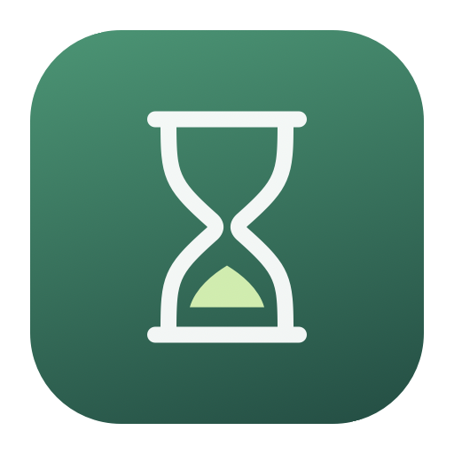
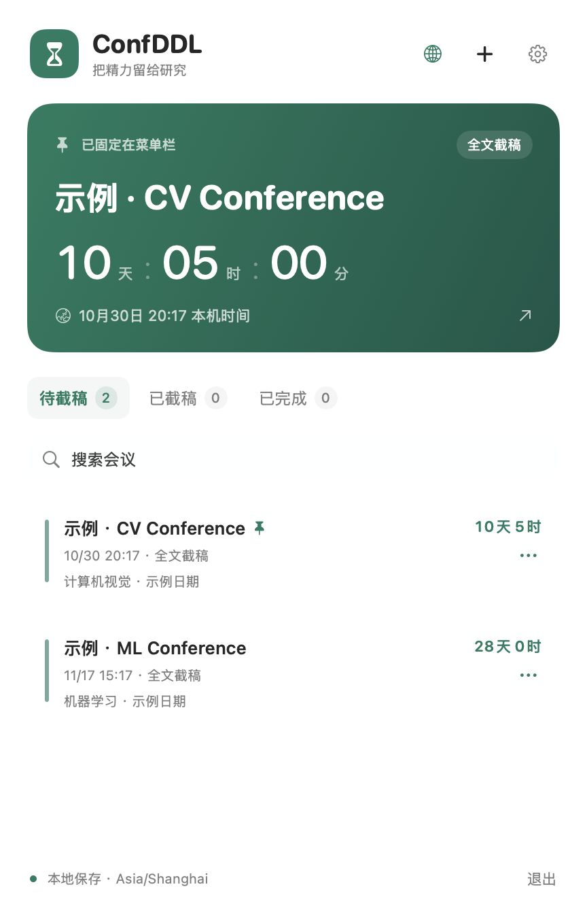
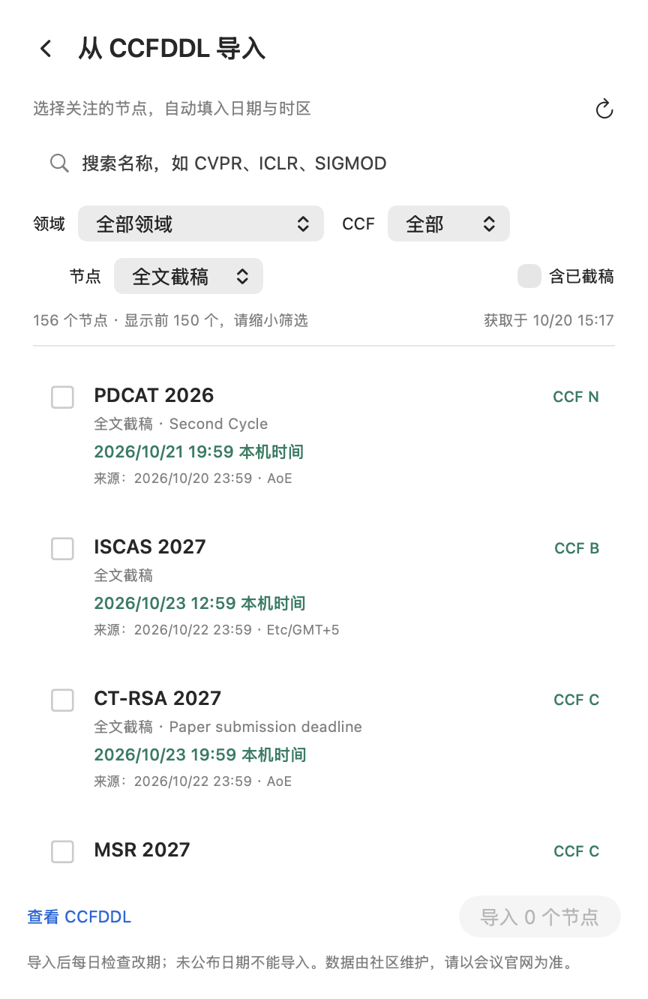

<div align="center">
  
  <h1>ConfDDL</h1>
  <p><strong>Conference deadlines. One glance away.</strong></p>
  <p>A native macOS menu bar app for paper deadlines, CCFDDL import, and local reminders.</p>
  <p>在 Mac 菜单栏查看会议截稿倒计时，导入 CCFDDL，专注每一次投稿。</p>
  <p>
    <a href="https://github.com/Valkqs/ConfDDL/actions/workflows/ci.yml"></a>
    
    
    <a href="LICENSE"></a>
  </p>
  <p>English · <a href="README.zh-CN.md">简体中文</a></p>
  <p><a href="#get-started">Get started</a> · <a href="#features">Features</a> · <a href="CONTRIBUTING.md">Contribute</a> · <a href="https://github.com/Valkqs/ConfDDL/issues">Report an issue</a></p>
</div>

<p align="center">
  
  
</p>
<p align="center"><sub>The current app interface is in Simplified Chinese. Screenshots illustrate the UI; demo dates are examples and source dates may change.</sub></p>

## Why ConfDDL?

Paper deadlines involve more than a date: AoE time zones, separate abstract submissions, multiple rounds, and occasional extensions. ConfDDL keeps the countdown in your menu bar and puts those details one click away.

Import the deadlines you care about, pin the next important submission, and keep your own notes. No account required. Your tracked conferences stay on your Mac.

## Features

| Feature | What it does |
| --- | --- |
| **Menu bar countdown** | Shows the nearest upcoming deadline, or a conference you pin. |
| **CCFDDL import** | Search by name and filter by research area, CCF rank, and deadline type. Import individual rounds and nodes. |
| **Time zone conversion** | Handles AoE, fixed UTC offsets, and Pacific Time with daylight saving. Displays the deadline in your Mac's time zone. |
| **Deadline updates** | Checks followed nodes daily while the app runs. Reschedules reminders after a date changes. |
| **Local reminders** | Choose 7 days, 3 days, 1 day, 1 hour, and the deadline itself. |
| **Your workflow** | Add conferences manually, edit notes, mark submissions complete, and import or export JSON backups. |
| **Native macOS controls** | Menu bar access, launch at login, and hover explanations for buttons and settings. |

## Get started

**Requirements:** macOS 13+, Xcode Command Line Tools, and Swift 5.9+. Apple Silicon has been tested locally; Intel builds still need validation.

Build and install from source:

```sh
git clone https://github.com/Valkqs/ConfDDL.git
cd ConfDDL
bash scripts/build.sh --install
```

If Command Line Tools are missing, run `xcode-select --install` first and finish Apple's installation dialog. Full Xcode is not required. The YAML parser is vendored, so Swift Package Manager does not need to fetch dependencies.

The app installs to `~/Applications/ConfDDL.app` and opens its menu panel. Look for the hourglass and `DDL` in the menu bar; it does not show a Dock icon. If an installation already exists, quit it and replace it with the newly built `dist/ConfDDL.app`.

**Build status:** current packages use a local ad-hoc signature and are not notarized. A signed download is planned; source installation is the documented path today.

### Add your first deadline

1. Click the **globe** button to open CCFDDL import.
2. Search for a conference and select the exact year, round, and deadline type you need.
3. Click **Import**. The countdown appears in the menu bar.
4. Open **Settings → System notifications** to enable reminders and allow macOS notification permission.

Use **＋** for a manual deadline, **···** for pinning and completion, and hover over a control for its explanation. See the [detailed Chinese guide](docs/guide.zh-CN.md) for all settings.

## How updates and time zones work

- **AoE = UTC−12.** October 20 at 23:59 AoE is October 21 at 19:59 in Beijing. Imported dates retain the source's seconds.
- **Each node is separate.** Abstract submission, full paper submission, Rebuttal, different rounds, and different years are tracked independently. `TBD` entries cannot be imported.
- **Your edits take priority.** Changing an imported date, time zone, or type pauses following for that node. Re-enable following in the editor to adopt source updates again.
- **Missing data is preserved.** If a source node disappears or becomes unpublished, ConfDDL keeps the previous local deadline and marks it for checking.
- **Only chosen nodes are followed.** The app does not automatically add next year's edition. Automatic checks require the app to be running; a manual refresh is available in Settings.

CCFDDL is community-maintained. Always confirm important dates on the conference's official website.

## Privacy and reminders

Tracked conferences and preferences are stored locally at:

```text
~/Library/Application Support/ConfDDL/deadlines.json
```

ConfDDL has no accounts, analytics, or conference uploads. Import and update operations download the public CCFDDL catalog; opening a website uses your default browser. A cached catalog supports offline browsing.

macOS schedules up to the nearest 60 reminders. ConfDDL replenishes the queue while running and after wake. Notifications already scheduled can be delivered after the app exits; later reminders need another run to enter the queue. A powered-off Mac cannot notify you, and Focus settings may silence alerts.

## Development

```sh
swift build                         # Compile the app and core checks
swift run DeadlineCoreChecks         # Deterministic core and CCFDDL checks
bash scripts/build.sh               # Build, create the icon, sign locally, and package
```

Output: `dist/ConfDDL.app` and `dist/ConfDDL-macOS.zip`. CI runs the checks and packaging on macOS and keeps the ZIP as a workflow artifact. Live network checks are separate from CI:

```sh
swift run DeadlineCoreChecks --fetch-ccf
```

The app uses SwiftUI and AppKit; deadline parsing, time zones, merging, persistence models, and reminder planning live in `Sources/DeadlineCore`. See [CONTRIBUTING.md](CONTRIBUTING.md) for the project layout and contribution process.

## Roadmap

- [ ] English app interface
- [ ] Developer ID signing and notarized downloads
- [ ] Validate Intel builds and prepare universal packages
- [ ] Additional conference sources and import formats

Ideas and reproducible bug reports are welcome in [Issues](https://github.com/Valkqs/ConfDDL/issues). If ConfDDL helps with your submissions, a star is a welcome way to support the project.

## Credits and license

Conference data comes from [CCFDDL](https://ccfddl.com) / [ccf-deadlines](https://github.com/ccfddl/ccf-deadlines). YAML parsing uses [Yams 6.2.2](https://github.com/jpsim/Yams), including LibYAML.

ConfDDL is available under the [MIT License](LICENSE). Third-party copyright and license details are listed in [THIRD_PARTY_NOTICES.md](THIRD_PARTY_NOTICES.md).
